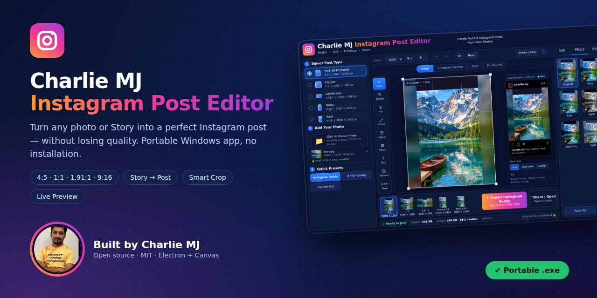

# Charlie MJ Instagram Post Editor



**Charlie MJ Instagram Post Editor** is a **portable Windows desktop application** designed to quickly transform any photo—or an existing Instagram Story—into a properly sized Instagram post while preserving image quality.

### Key Features

* 🖼️ Convert photos and Instagram Stories into Instagram-ready posts
* 📐 Automatically prepare images for the correct Instagram dimensions
* ✨ Preserve image quality during the editing and resizing process
* 🔒 Process your images locally without uploading them to external services
* 📦 Fully portable — no installation required
* 🚀 Runs directly from a single `.exe` file
* 👤 No account or registration required
* 🌐 No internet connection required

### Portable Download

**[Download Charlie MJ Instagram Post Editor](Win%20Portable-exe/Charlie-MJ-Instagram-Post-Editor-Portable.exe)**

> **One `.exe`. No installer. No account. No internet required.**

## Why I Made This

I created **Charlie MJ Instagram Post Editor** to solve a simple but common problem: preparing images for different Instagram formats without unwanted cropping, distortion, or unnecessary quality loss.

A photo captured or exported for an Instagram **Story (9:16)** does not naturally fit the **Feed Portrait format (4:5)**. When converted directly, important parts of the image can be cropped, resized incorrectly, or squeezed into an unsuitable aspect ratio.

General-purpose image editors can handle these tasks, but they are not specifically designed around Instagram's image formats and workflow. Online image-resizing services also require users to upload their photos to third-party servers, which may raise privacy concerns and can introduce additional compression.

I wanted a tool that was:

* **Simple** — focused specifically on Instagram image preparation.
* **Fast** — designed for quick editing and exporting.
* **Private** — images remain on the user's computer.
* **Offline** — no internet connection is required.
* **Portable** — no installation or setup process is necessary.
* **Instagram-aware** — built around common Instagram image formats and dimensions.

That idea became **Charlie MJ Instagram Post Editor**.

The complete background, problem statement, goals, and intended users are documented in:

**[Project Overview](docs/PROJECT-OVERVIEW.md)**

---

## Core Features

### Multiple Instagram Formats

The editor supports **five Instagram-oriented formats**:

* **Portrait** — the default feed format
* **Square**
* **Landscape**
* **Story**
* **Reel**

Each format maintains its own crop settings, allowing you to switch between formats without losing your previous editing work.

### Story → Post Conversion

One of the main features of the application is converting an Instagram Story into a feed-ready post.

The editor provides several background and composition options:

* **Smart Crop**
* **Blur Background**
* **Solid Background**
* **Gradient Background**
* **Mirror**
* **Manual positioning**

You can preview the result in real time before exporting the final image.

### Full Image Editor

The built-in editor provides essential image-editing controls without requiring a separate application.

Features include:

* Move and reposition images
* Zoom
* Crop
* Rotate
* Flip
* 10 color and adjustment sliders
* 9 built-in filters
* Text
* Stickers
* Before/After preview
* Undo and Redo

### Instagram-Style Live Preview

Instead of showing only the final cropped image, the application provides an Instagram-style preview so you can see how your image fits into different areas of the platform.

You can preview:

* The individual post
* Feed appearance
* Profile grid appearance

### High-Quality and Private Export

The application processes images locally on your computer and supports:

* **JPEG**
* **PNG**
* **WebP**
* Export resolutions up to **2160 px**
* Automatic removal of **EXIF/GPS metadata**
* Original image remains unchanged

Your original file is never modified during the editing process.

### Portable and Offline

Charlie MJ Instagram Post Editor is designed as a portable Windows application.

* Single `.exe` application
* No installer required
* No account required
* No cloud services
* No internet connection required
* Settings stored alongside the application
* Images processed locally

For the complete feature documentation, see:

**[Features Documentation](docs/FEATURES.md)**

---

## Technologies

Charlie MJ Instagram Post Editor is intentionally built with a lightweight technology stack.

### Core Technologies

* **HTML** — application structure and user interface
* **CSS** — layout and visual styling
* **JavaScript** — application logic and image-processing functionality
* **Canvas 2D API** — image rendering, manipulation, cropping, and processing
* **Electron** — Windows desktop application runtime
* **electron-builder** — application packaging and portable `.exe` generation

The project does not depend on a large frontend framework or cloud-based image-processing service.

The full technology stack and the reasoning behind these choices are documented in:

**[Technologies Documentation](docs/TECHNOLOGIES.md)**

For an overview of how the different parts of the application work together, see:

**[Architecture Documentation](docs/ARCHITECTURE.md)**

---

## Getting Started

### Just Want to Use the Application?

If you only want to use the application, download the portable executable:

**[Download Charlie MJ Instagram Post Editor](Win%20Portable-exe/Charlie-MJ-Instagram-Post-Editor-Portable.exe)**

You can run the application directly without installing it.

For a complete walkthrough, see:

**[User Guide](docs/USER-GUIDE.md)**

### Want to Run or Build It Yourself?

If you want to work with the source code, first install the project dependencies:

```bash
npm install
```

Run the application from source:

```bash
npm start
```

Build the portable Windows executable:

```bash
npm run dist
```

For detailed development instructions, project conventions, and guidance for extending the application, see:

**[Development Guide](docs/DEVELOPMENT.md)**

For packaging and publishing instructions, see:

**[Build Guide](docs/BUILD.md)**

---

## Documentation

The project includes detailed documentation covering the application's purpose, features, architecture, technology choices, usage, development, and release process.

### Documentation Index

* **[Project Overview](docs/PROJECT-OVERVIEW.md)**
  Explains the problem, project goals, intended users, and the reason behind the application.

* **[Features](docs/FEATURES.md)**
  Provides a detailed explanation of the application's features and planned improvements.

* **[Architecture](docs/ARCHITECTURE.md)**
  Explains how the application is structured and how its different components work together.

* **[Technologies](docs/TECHNOLOGIES.md)**
  Documents the technologies used in the project and explains why they were selected.

* **[User Guide](docs/USER-GUIDE.md)**
  Provides step-by-step instructions for using the application, including troubleshooting guidance.

* **[Development Guide](docs/DEVELOPMENT.md)**
  Covers running the project from source, project conventions, folder structure, and extending the application.

* **[Build Guide](docs/BUILD.md)**
  Explains how to build, package, and publish the portable Windows `.exe`.

---

## License

This project is released under the **MIT License**.

See the **[LICENSE](LICENSE)** file for the complete license terms.

**© Charlie MJ**

