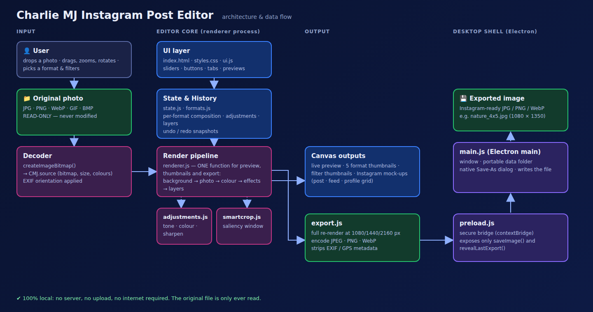

# Architecture

← [Docs index](README.md)

## Overview

Charlie MJ Instagram Post Editor is a **local, single-process desktop app**. There is no server, no
database, and no network call anywhere in the normal editing flow. Everything in the diagram above —
decoding the photo, cropping, adjusting colours, rendering the live preview, and encoding the export —
happens inside the Chromium renderer that Electron gives the app for free. Electron's *main* process is
only used for the handful of things a web page cannot do on its own: opening a native "Save as" dialog,
writing the exported file to disk, and revealing it in Explorer.

## The two processes

| Process | File | Responsibility |
|---|---|---|
| **Renderer** (the UI) | `src/index.html`, `src/css/styles.css`, `src/js/*.js` | Everything the person sees and interacts with: the whole editor, every pixel operation, the Instagram-style preview, export encoding |
| **Main** (Electron) | `main.js` | Creates the window, keeps the app portable, shows the native Save dialog, writes the exported file, reveals it in the folder |
| **Bridge** | `preload.js` | The only door between the two: exposes exactly two functions (`saveImage`, `revealLastExport`) to the renderer via `contextBridge`, with Node integration otherwise switched off |

Keeping the boundary this small means the renderer — which is what actually processes the photo — has no
filesystem or OS access at all. A bug in the image-editing code cannot touch anything outside the app.

## Module-by-module (renderer, `src/js/`)

Modules are loaded in this order (see the `<script>` tags in `src/index.html`), each one attaching its
public API to a shared `window.CMJ` namespace instead of using global variables:

1. **`state.js`** — the single source of truth. `CMJ.state` is one plain JSON object (current format,
   one "composition" per format, colour adjustments, filter, text/sticker layers, export settings).
   Because it is plain JSON, `CMJ.history` can snapshot it for Undo/Redo just by stringifying it.
2. **`formats.js`** — the list of Instagram presets (Portrait, Square, Landscape, Story, Reel, Custom)
   and lookup helpers.
3. **`smartcrop.js`** — a small, fully local heuristic. It downsamples the photo to ~120 px, scores every
   pixel by edge strength, colour saturation and a skin-tone bonus, then slides the target-ratio window
   across that score map to find the most interesting crop. No model, no internet.
4. **`adjustments.js`** — pure colour/effect maths (lookup tables for brightness/contrast/etc., a 3×3
   convolution for sharpening) plus the nine filter presets, which are just pre-set offsets on top of the
   same sliders.
5. **`renderer.js`** — the heart of the "what you see is what you get" guarantee. `CMJ.render.frame()` is
   the **one function** that draws background → photo (moved/zoomed/rotated/flipped) → colour adjustments
   → effects → layers, onto whatever canvas it is given. The live preview, the five format thumbnails, the
   nine filter thumbnails and the final export all call this same function at different sizes.
6. **`export.js`** — re-renders the composition at the chosen full resolution (1080/1440/2160 px — never
   upscaled from the small on-screen preview), encodes it as JPEG/PNG/WebP, and hands the bytes to
   `preload.js`'s `saveImage`, or triggers a normal browser download when the app is opened outside
   Electron.
7. **`ui.js`** — the only file that touches the DOM. It wires every button/slider/drag gesture to a change
   in `CMJ.state`, then asks the renderer to redraw. The rule of thumb used throughout: *user action →
   change state → request render → sync controls*.
8. **`sample.js`** — a small demo photo embedded as a base64 data URI, used only by "Try sample photo" (a
   `file://` image can taint a canvas in some browsers; a data URI never does).
9. **`app.js`** — the entry point: creates an empty state and calls `CMJ.ui.init()` once the page loads.

## Data flow for the signature feature (Story → Post)

1. A photo is decoded once into `CMJ.source` (a bitmap + dimensions) and **never modified**.
2. Switching the output format looks up (or creates) that format's `comp` (composition): crop position,
   zoom, rotation, flips, and background method.
3. `CMJ.State.autoMethod()` compares the photo's aspect ratio with the target's: close ratios default to
   Smart Crop, very different ratios (a 9:16 Story into a 4:5 post) default to a blurred-background fit so
   nothing is cut off. The person can override this from the "Story → Post fit" panel at any time.
4. `renderer.js` draws that composition into the live preview, the thumbnail strip, and — on export — a
   full-resolution canvas, which is then encoded and saved.

## Why this design

- **Trustworthy preview** — one render function for every surface means there is no separate "export
  path" that could drift from what the preview shows.
- **Non-destructive by construction** — `CMJ.source` is read-only; every visible pixel is a fresh draw
  from it, so Reset/Undo can always get back to the original photo.
- **Privacy by construction** — because export re-draws the photo onto a new canvas rather than copying
  the original file's bytes, EXIF/GPS/camera metadata is dropped automatically, not by a separate
  "strip metadata" step that could be forgotten.
- **Small, auditable trust boundary** — the only code with filesystem access is `main.js` and the two
  functions `preload.js` exposes; the entire image-processing pipeline runs in a sandboxed renderer.

See [TECHNOLOGIES.md](TECHNOLOGIES.md) for what each part is built with, and [DEVELOPMENT.md](DEVELOPMENT.md)
for how to run and extend it.

← [Docs index](README.md)
