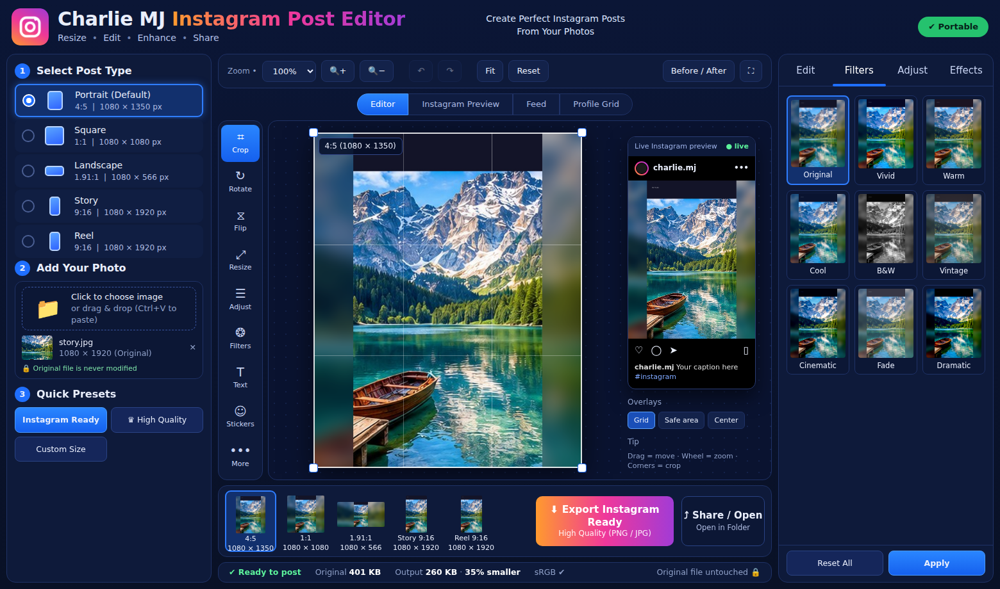

# Features

← [Docs index](README.md)

## 1. Instagram formats (Select Post Type)

| Format | Size | Ratio |
|---|---|---|
| **Portrait (default)** | 1080 × 1350 | 4:5 |
| Square | 1080 × 1080 | 1:1 |
| Landscape | 1080 × 566 | 1.91:1 |
| Story | 1080 × 1920 | 9:16 |
| Reel | 1080 × 1920 | 9:16 |
| Custom | any size 100–4096 px | any |

- Switching format **never loses work**: every format remembers its own position, zoom, rotation, flips and background.
- The bottom bar shows a **live thumbnail of every format** at once, each with its own crop.

## 2. Story → Post conversion (the signature feature)

When the photo's shape does not match the target, choose how to handle it (right panel → *Story → Post fit*):

| Method | What it does |
|---|---|
| **Smart crop** | Finds the most interesting region and crops there |
| **Blur bg** | Fits the whole photo and fills the gaps with a blurred copy (adjustable amount) |
| **Solid** | Fits the photo on a colour of your choice |
| **Gradient** | Fits the photo on a gradient built from the photo's own edge colours |
| **Mirror** | Extends the photo by reflecting its edges |
| **Manual** | Crop yourself with drag / wheel / corner handles |

On load, the app picks automatically: nearly-matching shapes are smart-cropped; very different shapes (a 9:16 Story into 4:5)
are **fitted with a blurred background, so nothing is cut**.

## 3. Editing tools

- **Move** (drag), **Zoom** (wheel, buttons, slider, 25 %–400 %), **corner handles** for cropping, **Straighten / Rotate** (any angle, 90° / 180° buttons), **Flip** H/V
- **Adjustments**: brightness, contrast, saturation, vibrance, sharpness, exposure, highlights, shadows, temperature, tint
- **Effects**: blur, vignette, fade
- **9 filters** with live thumbnails: Original, Vivid, Warm, Cool, B&W, Vintage, Cinematic, Fade, Dramatic (they stack with the sliders)
- **Text & stickers**: multiple layers, colour, size, bold, drag to position
- **Before / After**: hold the button to see the untouched photo
- **Undo / Redo** (100 steps), *Reset* (this format), *Reset All*
- Double-click any slider to reset it

## 4. Instagram preview studio

- **Live Instagram preview** card next to the canvas (uses Instagram's 4:5 feed crop)
- Full views: **Instagram Preview**, **Feed** (between neighbouring posts), **Profile Grid** (3-column tile)
- **Overlays**: rule-of-thirds grid, centre guide, Story/Reel **safe area**

## 5. Quality & export

- Photo is drawn with high-quality resampling; export re-renders at full size (never upscaled from the preview)
- **JPEG / PNG / WebP**, quality slider, resolution 1080 / 1440 / 2160 px, custom file name
- **Estimated output size** and "% smaller than original" in the status bar
- **Ready-to-post check**: warns if the photo is being enlarged (would look soft)
- **Metadata privacy**: EXIF, GPS and camera info are not written to exported files
- **Original never modified** – all edits are non-destructive
- **Quick presets**: *Instagram Ready* (Portrait, JPEG 92, 1080 px), *High Quality* (JPEG 98, 1440 px), *Custom Size*

## 6. Input

Click to choose · drag & drop · paste from clipboard (Ctrl+V). Supported: JPG, PNG, WebP, GIF, BMP (whatever Chromium can decode).
EXIF rotation is applied automatically. A built-in sample photo lets you try the app instantly.

## 7. Desktop / portable

Single `.exe`, no installation, no admin rights, settings stored beside the exe (`CharlieMJ-Data/`), fully offline, dark UI.

## Roadmap

Ideas from the original specification that are **not implemented yet**:

- Batch processing and multi-format export in one click, bulk rename
- True AI subject detection (current Smart Crop is a fast heuristic, not a neural network) and AI background expansion
- HEIC / TIFF / AVIF input-output, SVG import
- Project files (save/re-open an edit), custom user presets
- LUT (`.cube`) import, perspective correction
- Light theme, Ctrl+K command palette, watermark tool
- Code-signed installer-free build (removes the Windows SmartScreen prompt)

Contributions welcome — see [DEVELOPMENT.md](DEVELOPMENT.md).
