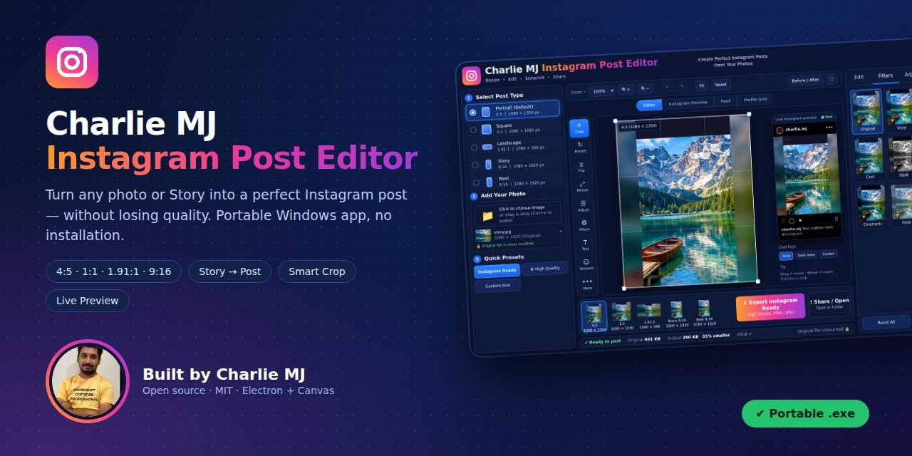

# Project overview

## What is Charlie MJ Instagram Post Editor?

A **portable Windows desktop app** that prepares photos for Instagram. You drop in a picture, choose an
Instagram format, and the app resizes / crops / pads it to the exact pixel size Instagram wants — with a live
preview that looks like a real Instagram post — then exports a clean, high-quality file.

It is a single `.exe`: **no installer, no account, no internet, no upload.** Copy it to a USB stick and it works.

## The problem it solves

Instagram uses different canvas shapes for different places:

| Place | Size | Ratio |
|---|---|---|
| Feed – Portrait (best for photos) | 1080 × 1350 | 4:5 |
| Feed – Square | 1080 × 1080 | 1:1 |
| Feed – Landscape | 1080 × 566 | 1.91:1 |
| Story / Reel | 1080 × 1920 | 9:16 |

The everyday pain:

1. You have a picture made for a **Story (9:16)** and want to post it in the **feed (4:5)**. Instagram crops it or
   shows it differently, and important content (faces, text) gets cut off.
2. General photo editors are heavy, complicated, and don't know Instagram's rules.
3. Online resizers upload your private photos to someone else's server and often re-compress them until they look blurry.
4. Instagram re-compresses everything, so starting from a badly resized file makes the final post look soft.

## Why this project was created

To have **one fast, private, purpose-built tool** that answers "how will this photo look on Instagram?" *before*
posting — and that never destroys the picture while getting it into shape.

The core idea, **Instagram Format Studio**: one photo → five Instagram formats, each with its own remembered crop,
all visible at once, with smart choices instead of blind cropping.

## Benefits

- **No lost content** – tall Stories are fitted with a blurred / mirrored / gradient / solid background instead of being chopped.
- **Smart Crop** – when cropping is right, the app finds the interesting part of the photo (detail, colour, skin tones) instead of cutting from the centre.
- **Exact sizes** – exports 1080-pixel-wide files (or 1440 / 2160) in the correct aspect ratio, so Instagram does not need to resize again.
- **Trustworthy preview** – the preview, thumbnails and export use the same rendering code: what you see is what you get.
- **Privacy** – everything runs locally; exported files contain no EXIF/GPS data.
- **Original is safe** – the source file is only read, never modified.
- **Portable & light** – one `.exe`, no installation, works offline.
- **Beginner-friendly, capable for advanced users** – one-click *Export Instagram Ready*, plus sliders, filters, layers and export settings.

## Who is it for?

Content creators, photographers, small-business owners and social-media managers who post to Instagram from a
Windows PC and want quick, reliable, private results.

## About the author

**Charlie MJ** — Microsoft Certified Professional and creator of this project.

> ✏️ *Add a website, LinkedIn or GitHub link here if you'd like it to appear alongside your photo.*

## Project status

Version **1.0.0**. Fully working editor; see [FEATURES.md](FEATURES.md#roadmap) for what is planned next.

← [Docs index](README.md)
